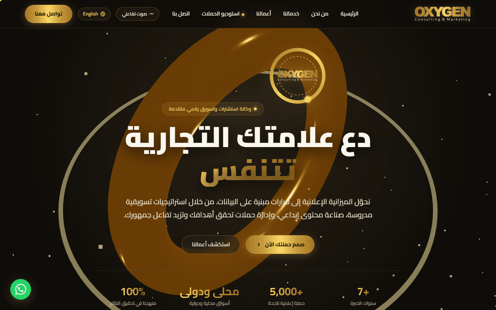
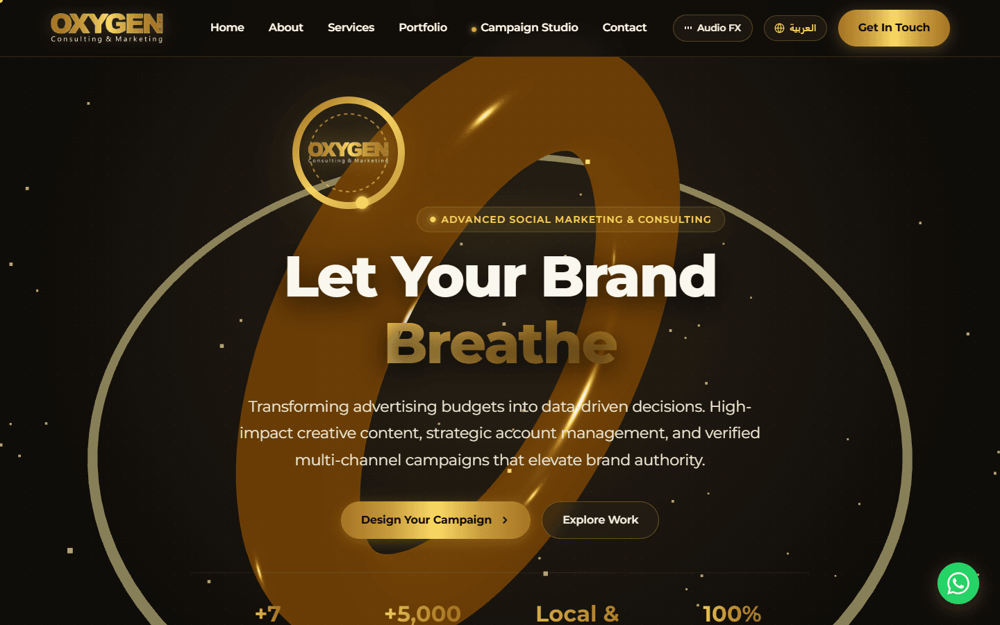
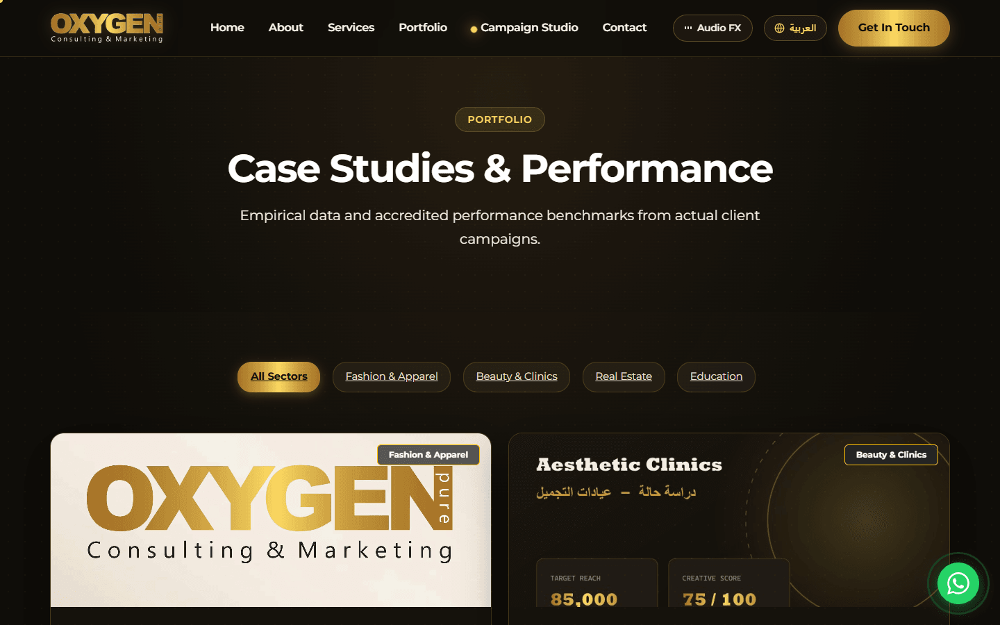
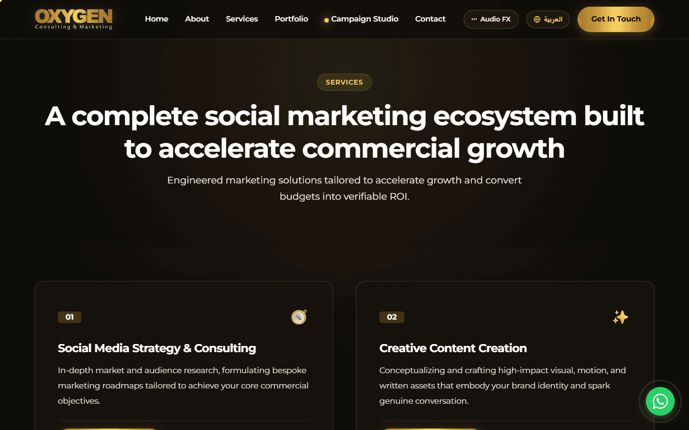
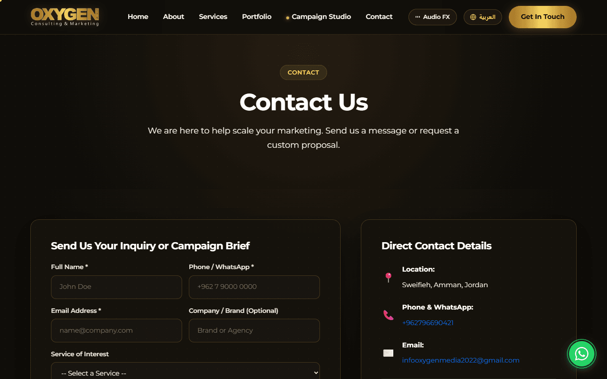
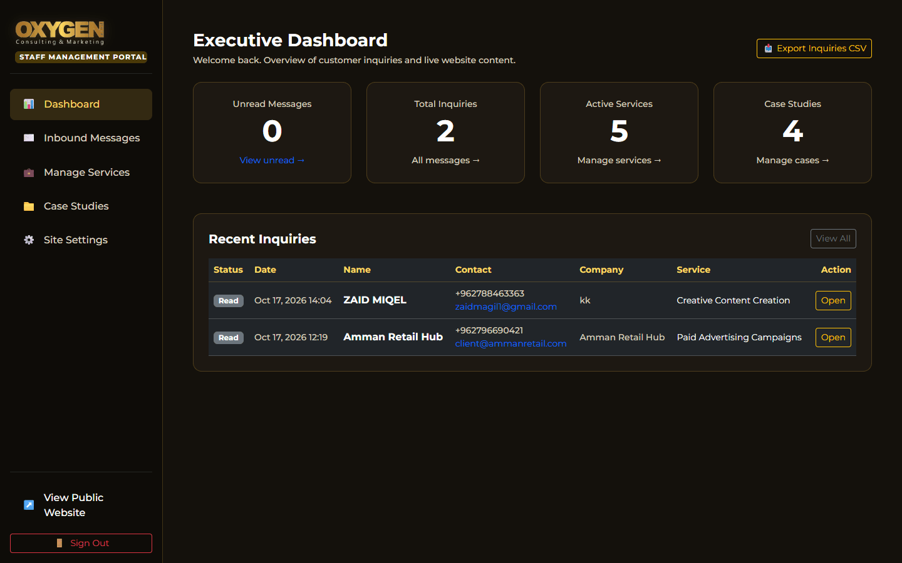
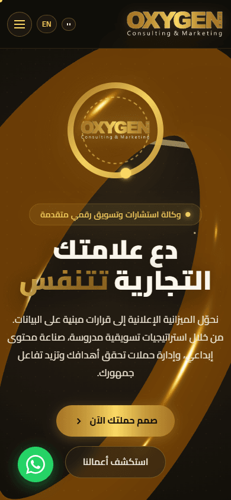
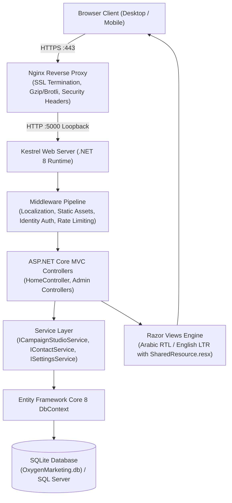

# Oxygen Consulting & Marketing | Bilingual Agency Website

> **"Let Your Brand Breathe"**  
> A bilingual, enterprise-grade digital experience and administrative web platform built with ASP.NET Core 8 MVC, Entity Framework Core, Three.js, and GSAP.

[](https://github.com/Zaidmaqel/oxygen-consulting-website/actions/workflows/ci.yml)
[](https://dotnet.microsoft.com/download)
[](https://dotnet.microsoft.com/apps/aspnet/mvc)
[](https://learn.microsoft.com/ef/core/)
[](https://www.sqlite.org/)
[-7952B3?logo=bootstrap&logoColor=white)](https://getbootstrap.com/)
[](https://threejs.org/)
[](https://gsap.com/)
[](LICENSE)



---

## About the Project

Oxygen Consulting & Marketing is a social media marketing and consulting agency headquartered in Sweifieh, Amman, Jordan. The company specializes in data-driven advertising campaigns, content creation, social media growth, and strategic advisory for retail, healthcare, real estate, and education sectors across Jordan.

This website was engineered as a comprehensive hiring-assessment project for Oxygen Consulting & Marketing. It incorporates the client's verified company details, official social links, and brand assets used with their permission. The visual and technical concept centers on *"The Brand That Breathes"*: the entire user interface integrates subtle, organic breathing motion cycles tied to the brand's slogan (*"Let Your Brand Breathe"* / *"دع علامتك تتنفس"*).

> **Note on Case Study Figures**: All campaign performance metrics, budgets, and reach numbers displayed in the public portfolio and configurator are editable sample data designed for technical evaluation and client demonstration, rather than verified production audit results.

---

## Key Features

### Experience and Frontend
- **3D Interactive Golden Ring Hero**: Procedural translucent golden glass torus rendered in WebGL via Three.js with physical transmission, clearcoat highlights, ambient golden embers, cursor tilt tracking, and organic breathing scale. Includes graceful CSS fallbacks for reduced-motion settings and mobile hardware.
- **Build-Your-Campaign Studio**: Real-time campaign configurator featuring an animated SVG orbital ring where selected advertising platforms and service tiers orbit dynamically using GSAP. Live estimates for budget, projected reach, and expected customer inquiries are computed instantly.
- **Scroll Storytelling**: Sequenced four-stage narrative (*Strategy → Content → Campaigns → Analysis*) controlled by GSAP ScrollTrigger, animating complete Arabic word segments rather than breaking cursive typography.
- **Brand Pulse Radar and Analytics**: Interactive radar interface with sweeping beam and empirical case markers, alongside animated count-up KPI metrics and SVG telemetry curves.
- **Filterable Portfolio**: Glassmorphism project cards with 3D perspective hover tilt, industry sector filtering (*Fashion, Beauty Clinics, Real Estate, Education*), and before-and-after campaign analysis.
- **Interaction Details**: Custom gold ring cursor with velocity trail, smooth inertia scrolling powered by Lenis, page transition fades, and an interactive brand celebration easter egg.

### Bilingual Architecture
- **Arabic and English Support**: Full right-to-left (RTL) layout for Arabic and left-to-right (LTR) layout for English.
- **Culture Selection**: Driven by ASP.NET Core `CookieRequestCultureProvider` with culture switching preserved across all routes.
- **Localization Infrastructure**: Strongly typed resource files (`SharedResource.ar.resx`, `SharedResource.en.resx`) for UI copy, alongside dual-column localized database schemas (`TitleAr` / `TitleEn`, `DescriptionAr` / `DescriptionEn`).
- **Typography and Fonts**: Completely self-hosted Google Fonts (*Cairo* and *Reem Kufi* for Arabic, *Montserrat* for English) to eliminate external CDN dependencies and optimize render speed.

### Administrative Management Portal
- **Private Staff Area (`/admin`)**: Dedicated administration section without public registration or discovery links, protected by ASP.NET Core Identity role-based authorization (`[Authorize(Roles = "Admin")]`).
- **Inbound Message Inbox**: Review customer inquiries from the contact form and Campaign Studio, manage read/unread status, delete entries, and export inquiries to CSV formatted with a UTF-8 Byte Order Mark (BOM) for clean Arabic rendering in Microsoft Excel.
- **Service Catalog CRUD**: Create, edit, reorder, and toggle publication states for agency services in both languages.
- **Case Studies CRUD**: Manage case study details, campaign metrics, improvement percentages, and image uploads with file extension and size validation.
- **Site Coordinates**: Live management of official telephone, email, physical headquarters address, social media URLs, and embedded map locations.

### Security, Performance, and SEO
- **Protection**: Automated CSRF anti-forgery token validation on all form posts, honeypot spam traps, and client IP rate limiting (maximum 5 submissions per hour).
- **HTTP Security Headers**: Configured Content-Security-Policy (CSP), X-Frame-Options (`SAMEORIGIN`), X-Content-Type-Options (`nosniff`), and Referrer-Policy.
- **SEO Ready**: Canonical URLs, localized `hreflang` alternate links, JSON-LD structured data for LocalBusiness, Open Graph social share cards, and a dynamic XML sitemap.
- **Accessibility & Motion Safety**: Media query compliance for `@media (prefers-reduced-motion: reduce)` that halts 3D rotation, radar sweeps, and continuous marquee transforms.

---

## Screenshots

| View | Screenshot |
| :--- | :--- |
| **Home (Arabic RTL)** |  |
| **Home (English LTR)** |  |
| **Campaign Studio Configurator** |  |
| **Portfolio & Case Studies** |  |
| **Service Offerings** |  |
| **Contact & Inquiries** |  |
| **Staff Admin Dashboard** |  |
| **Mobile Responsive View** |  |

---

## Tech Stack

| Layer | Technology | Why I Chose It |
| :--- | :--- | :--- |
| **Application Framework** | ASP.NET Core 8 MVC (C# 12) | Modern LTS platform delivering high-throughput performance, built-in dependency injection, strongly typed Razor views, and mature middleware. |
| **Data Access** | Entity Framework Core 8 | Industry-standard ORM with Code-First migrations, LINQ query generation, and provider-agnostic database swapping. |
| **Database** | SQLite (Default) / SQL Server | Zero-configuration local development and testing with SQLite; architectural separation allows instant migration to Microsoft SQL Server in production. |
| **Authentication & Security** | ASP.NET Core Identity | Secure password hashing (PBKDF2 with HMAC-SHA256), brute-force account lockout tracking, and cookie-based role management. |
| **CSS Framework** | Bootstrap 5.3 (RTL & LTR) | Modular responsive grid system with dedicated native RTL stylesheet (`bootstrap.rtl.min.css`) and custom CSS variable themes. |
| **3D Rendering** | Three.js (r169) | WebGL rendering pipeline enabling procedural materials, custom lighting, and responsive geometry for the golden ring hero element. |
| **Animation Engine** | GSAP 3.12 & ScrollTrigger | High-performance timeline sequencing, buttery-smooth scroll-driven progress animations, and SVG orbital motion paths. |
| **Smooth Scrolling** | Lenis v1.1 | Lightweight, accessible smooth scroll library providing consistent inertial scrolling across desktop browsers. |
| **Logging** | Serilog 8.0 | Structured logging sink writing rolling daily diagnostic files to `logs/` and stdout console streams. |
| **Unit Testing** | xUnit, Moq, EF Core InMemory | Isolated test suite validating business calculations, form validation rules, and contact submission services. |

---

## Architecture

### Request Lifecycle



### Folder Structure

```
oxygen-consulting-website/
├── .github/
│   └── workflows/
│       └── ci.yml               # GitHub Actions CI build and test workflow
├── docs/
│   ├── DEPLOYMENT.md            # Ubuntu Linux (Nginx/systemd) & IIS deployment guide
│   └── screenshots/             # Production UI captures (1440x900 & 390x844)
├── src/
│   └── OxygenMarketing/
│       ├── Areas/Admin/         # Staff portal controllers, view models, and views
│       ├── Controllers/         # Public MVC controllers (Home, Studio, Inquiries)
│       ├── Data/                # ApplicationDbContext, migrations, and DbSeeder
│       ├── Models/              # Domain entities (Service, CaseStudy, ContactMessage, SiteSetting)
│       ├── Properties/          # launchSettings.json profile configurations
│       ├── Resources/           # Strongly-typed localization resources (.resx)
│       ├── Services/            # Business services (CampaignStudio, Contact, Email, Files, Settings)
│       ├── ViewModels/          # Strongly-typed view models and DTO contracts
│       ├── Views/               # Razor views, partials, and shared layouts (RTL/LTR)
│       ├── wwwroot/             # Self-hosted CSS, JS, fonts, icons, and brand graphics
│       ├── appsettings.json     # Base configuration file (no secrets)
│       ├── appsettings.Production.example.json  # Production template with placeholder keys
│       └── Program.cs           # Host builder, DI container configuration, middleware pipeline
├── tests/
│   └── OxygenMarketing.Tests/   # Unit tests project (xUnit + Moq)
├── tools/
│   └── screenshots/             # Playwright screenshot automation script
├── .editorconfig                # Solution code formatting standards
├── .gitignore                   # Exclusions for build outputs, databases, and secrets
├── LICENSE                      # MIT License with brand asset exception
├── OxygenMarketing.sln          # Visual Studio solution file
├── README.md                    # Primary repository documentation
├── run.bat                      # Windows quick-launch batch file
└── run.ps1                      # PowerShell test runner and dev launcher
```

---

## How the Campaign Studio Estimate Works

The **Build-Your-Campaign Studio** provides real-time estimates to help prospective clients gauge the scale of a campaign before submitting an inquiry. 

The calculation logic (`CampaignStudioService.cs`) is proportional:
1. **Platform Allocation**: Each selected advertising channel (Facebook, Instagram, Google Ads, TikTok, LinkedIn, Snapchat) introduces an estimated monthly management baseline ranging from $250 to $420 depending on platform complexity.
2. **Service Component Weights**: Additional service tiers (Paid Campaign Management, Content Production, Video Production, Brand Identity) add proportional baseline cost components based on typical production hours.
3. **Objective Multipliers**: Campaign objectives calibrate the projection:
   - *Brand Awareness*: Applies a 1.45x multiplier to estimated impressions.
   - *Direct Messaging / Inquiries*: Calibrates projections toward higher direct conversation volume (~3.5 conversations per advertising dollar).
   - *Store Visits / Lead Generation*: Weights toward local geographic delivery and high-intent click-through rates.
4. **Duration Scaling**: Budgets scale linearly with campaign duration, applying a modest 5% efficiency discount on multi-month engagements.

> **Disclaimer**: Projections computed by the Studio are illustrative estimates derived from sample benchmarks. They do not constitute a binding quotation or guaranteed campaign return.

---

## Getting Started

### Prerequisites
- [.NET 8 SDK](https://dotnet.microsoft.com/download/dotnet/8.0) (v8.0.100 or higher)
- Optional: [Node.js](https://nodejs.org/) (v18+) if you wish to run the Playwright screenshot tool

### Clone and Restore

```bash
git clone https://github.com/Zaidmaqel/oxygen-consulting-website.git
cd oxygen-consulting-website

# Restore NuGet dependencies
dotnet restore OxygenMarketing.sln
```

### Configure Secrets via `dotnet user-secrets`

The application uses ASP.NET Core User Secrets in Development so that passwords never touch source control. Initialize and configure your local administrator password:

```bash
# Navigate to the web project directory
cd src/OxygenMarketing

# Set your local admin password (must be at least 8 characters with digit, lowercase, and uppercase)
dotnet user-secrets set "AdminUser:Password" "AdminPass@2026!Local"

# Return to solution root
cd ../..
```

### Run the Application

```bash
dotnet run --project src/OxygenMarketing/OxygenMarketing.csproj --urls "http://localhost:5200"
```

Once running, access the application in your browser:
- **Public Website**: `http://localhost:5200`
- **Staff Admin Portal**: `http://localhost:5200/admin/login`

> **Automatic Database Initialization**: On initial startup, `DbSeeder.cs` automatically creates the SQLite database (`OxygenMarketing.db`), applies EF Core migrations, and seeds initial services, case studies, company coordinates, and the admin user configured in your user secrets.

### Accessing the Admin Area
1. Navigate to `http://localhost:5200/admin/login`.
2. Sign in with:
   - **Email**: `admin@oxygen.jo`
   - **Password**: The password you set with `dotnet user-secrets` above.

---

## Configuration

Configuration keys are managed through `appsettings.json`, environment variables, or `dotnet user-secrets`:

| Configuration Key | Purpose | Example / Default | Required |
| :--- | :--- | :--- | :--- |
| `ConnectionStrings:DefaultConnection` | Database connection string (SQLite or SQL Server). | `Data Source=OxygenMarketing.db` | Yes |
| `AdminUser:Email` | Initial administrator login email. | `admin@oxygen.jo` | Yes |
| `AdminUser:Password` | Password for administrator account creation. | Configured via `dotnet user-secrets` or env. | Yes |
| `AdminUser:FullName` | Display name for the administrator user. | `Oxygen Executive Administrator` | No |
| `ContactSettings:NotificationEmail` | Target email for contact form notifications. | `info@oxygen.jo` | No |
| `Smtp:Enabled` | Enables real SMTP dispatch for inquiries. | `false` | No |
| `Smtp:Host` | SMTP mail server hostname. | `smtp.example.com` | If SMTP enabled |
| `Smtp:Port` | SMTP mail server port. | `587` | If SMTP enabled |
| `Smtp:Username` | SMTP authentication username. | `apikey` | If SMTP enabled |
| `Smtp:Password` | SMTP authentication password. | Managed via secrets / environment. | If SMTP enabled |
| `Smtp:FromEmail` | Outgoing sender email address. | `no-reply@oxygen.jo` | If SMTP enabled |
| `AllowedHosts` | Allowed HTTP Host headers for security. | `*` (Dev) / `oxygen.jo;www.oxygen.jo` (Prod) | Yes |

### Switching from SQLite to Microsoft SQL Server

The data layer is provider-agnostic. To switch to Microsoft SQL Server:

1. Add the SQL Server NuGet provider:
   ```bash
   dotnet add src/OxygenMarketing/OxygenMarketing.csproj package Microsoft.EntityFrameworkCore.SqlServer --version 8.0.10
   ```
2. In `src/OxygenMarketing/Program.cs`, replace:
   ```csharp
   options.UseSqlite(connectionString);
   ```
   with:
   ```csharp
   options.UseSqlServer(connectionString, sql => sql.EnableRetryOnFailure());
   ```
3. Update `ConnectionStrings:DefaultConnection` in `appsettings.Production.json` or your environment variables:
   ```
   Server=tcp:your-server.database.windows.net,1433;Initial Catalog=OxygenMarketingDb;User ID=admin_user;Password=YourPassword;Encrypt=True;TrustServerCertificate=False;
   ```

---

## Testing

The solution includes an automated test suite (`tests/OxygenMarketing.Tests`) verifying domain logic and application behavior:

```bash
# Run all tests in the solution
dotnet test OxygenMarketing.sln
```

### What the Tests Cover
- **Campaign Studio Calculation Engine (`CampaignStudioServiceTests.cs`)**:
  - Verification of minimum budget floors across platform counts.
  - Multiplier accuracy for Brand Awareness, Inquiries, and Traffic objectives.
  - Duration scaling and engagement discount formulas.
  - Graceful boundary handling for empty platform or service selections.
- **Contact Form Validation (`ContactFormValidationTests.cs`)**:
  - Mandatory field constraints (Name, Email, Message).
  - Regular expression validation for email formats and Jordan/international telephone numbers.
  - Length limits protecting against buffer overflow and database truncation.
- **Contact Service Submission (`ContactServiceTests.cs`)**:
  - IP-based rate limiting rejecting more than 5 submissions per hour.
  - Silent bot mitigation via honeypot traps.
  - Proper UTF-8 message persistence in EF Core.

---

## Deployment

A complete production deployment guide for Ubuntu Linux (Kestrel + Nginx + systemd + Let's Encrypt SSL) and Windows Server (IIS) is documented in [docs/DEPLOYMENT.md](docs/DEPLOYMENT.md).

### Deployment Summary
- **Operating System**: Ubuntu 22.04 or 24.04 LTS VPS
- **Process Manager**: `systemd` running `oxygen.service` with automatic restart and environment secret overrides.
- **Reverse Proxy**: Nginx handling SSL termination, static file caching, client payload limits, and proxying loopback traffic to Kestrel on port 5000.
- **TLS/SSL**: Automated HTTPS certificates via Let's Encrypt Certbot.

---

## What I Learned

- **Bilingual Layout Architecture**: Implementing bidirectional layouts requires more than flipping text alignment. It demands isolating margin/padding directionals, using logical CSS properties (`margin-inline-start`), swapping Bootstrap RTL and LTR builds dynamically, and designing animations that maintain their optical balance whether moving left-to-right or right-to-left.
- **Respecting Arabic Typography in Animation**: Word-splitting techniques commonly used in English typography animations break the cursive connections between Arabic letters. Creating natural Arabic scroll storytelling required keeping whole words intact and animating opacity and vertical translation at the word boundary.
- **Secure Secret Separation**: Eliminating plaintext passwords from configuration files while keeping zero-friction onboarding for new developers. Using .NET user secrets for local runs and environment variables in production ensures credentials never enter git history.
- **Lightweight 3D WebGL Performance**: Rendering physical glass materials with transmission and roughness in Three.js can stress mobile GPUs. Implementing capability checks, capping pixel ratios (`Math.min(window.devicePixelRatio, 2)`), and offering clean CSS fallbacks for mobile and `prefers-reduced-motion` creates a smooth experience across devices.
- **Identity Lockout and Rate Limiting**: Combining ASP.NET Core Identity's account lockout (5 failed attempts locks for 15 minutes) with in-memory IP rate limiting on public inquiry endpoints prevents brute force abuse and spam floods without adding external CAPTCHA friction.

---

## Development Process

This project was developed with AI-assisted software engineering tools to accelerate component scaffolding, shader prototyping, and localization mapping. Every architectural decision, service contract, security mechanism, and test was reviewed, verified, and tuned by me to ensure strict compliance with ASP.NET Core best practices and high engineering standards.

---

## Roadmap

- [ ] **Client Production Data**: Replace placeholder case-study metrics with verified analytics once provided by the agency.
- [ ] **Agency Blog Section**: Markdown-powered marketing insights and SEO articles in Arabic and English.
- [ ] **Direct Social API Integration**: Connect Facebook Graph API and Instagram Basic Display API for automated feed previews.
- [ ] **Automated End-to-End Testing**: Integrate Playwright browser tests into the GitHub Actions CI pipeline.

---

## License and Credits

### Source Code License
The application source code is licensed under the [MIT License](LICENSE).

### Brand Assets & Trademark Notice
The **Oxygen Consulting & Marketing** name, logo, wordmarks, brand guidelines, and client promotional media are proprietary intellectual property of **Oxygen Consulting & Marketing** (Sweifieh, Amman, Jordan). These brand assets are included in this repository solely for portfolio demonstration and technical evaluation with permission, and are explicitly excluded from the MIT License.

### Third-Party Libraries
- [Bootstrap 5.3](https://getbootstrap.com/) — MIT License
- [Three.js](https://threejs.org/) — MIT License
- [GSAP & ScrollTrigger](https://gsap.com/) — Standard GreenSock License
- [Lenis](https://github.com/darkroomengineering/lenis) — MIT License
- [Serilog](https://serilog.net/) — Apache 2.0 License
- [Google Fonts (Cairo, Montserrat, Reem Kufi)](https://fonts.google.com/) — Open Font License (OFL)

---

## Author

**Zaid Hasan**  
- GitHub Profile: [@Zaidmaqel](https://github.com/Zaidmaqel)  
- Portfolio Repository: [oxygen-consulting-website](https://github.com/Zaidmaqel/oxygen-consulting-website)
